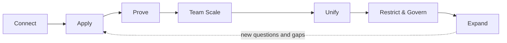

# The CAPTURE Framework

**A practical framework for implementing Agentic Analytics** — from connecting the first analyst
to real corporate data to a governed analytical capability available directly to the people
who make decisions.

> **Connect. Play. Scale.**

## Read the framework

- **English:** [CAPTURE-Framework.md](CAPTURE-Framework.md)
- **Русский:** [CAPTURE-Framework.ru.md](CAPTURE-Framework.ru.md)

Designed editions:

- **Web:** [1even-lab.github.io/capture-framework](https://1even-lab.github.io/capture-framework/) —
  the Russian edition is readable online
- **PDF (English):** [download](https://github.com/1even-lab/capture-framework/releases/latest/download/CAPTURE-Agentic-Analytics-Framework-1.0.pdf)
  from the latest [release](https://github.com/1even-lab/capture-framework/releases/latest)

Version 1.0. Both editions describe the same framework. The English edition is the fuller
one; the Russian edition is a more concise editorial version, not a line-by-line translation.

## What is Agentic Analytics

> Agentic Analytics is an approach in which AI agents use governed access to corporate data,
> business context and analytical methods to perform multi-step analytical work in response to
> a business question.

It is not Text-to-SQL. It is the delegation of analytical work to an AI agent: the user asks a
business question, and the agent plans the investigation, queries the data, tests hypotheses,
iterates and explains a supported conclusion. The person still owns the question, the
verification and the decision.

## The seven stages

CAPTURE is the implementation sequence. It starts with real analytical work and builds the
platform from what is learned, instead of designing the platform first.

| | Stage | What happens |
|---|---|---|
| **C** | **Connect** | Connect a small trusted data team to real corporate data. |
| **A** | **Apply** | Start playing with real analytical work and real business questions. |
| **P** | **Prove** | Verify answers, correct mistakes and teach the agent. |
| **T** | **Team Scale** | Expand the working setup across the analytics team. |
| **U** | **Unify** | Turn accumulated semantics, skills and knowledge into a structured Analytics Harness. |
| **R** | **Restrict & Govern** | Establish enterprise security, permissions and governance for broader access. |
| **E** | **Expand** | Bring proven analytical capability directly to business decision-makers. |

CAPTURE is both a rollout framework and a continuous learning loop: business usage keeps
exposing new questions and gaps, which go back through verification into the Harness.

## Principles it rests on

- **The ultimate product of analytics is a management decision** — measured by Decision
  Velocity and Decision Quality, not by the volume of analytical output.
- **Real work first.** Do not design Agentic Analytics in theory; let real analytical work show
  what the system needs to know.
- **Every mistake should make the analytical capability better.** Verification is not only
  quality control — it is how the system learns the organization.
- **Every fact has one owner.** Never copy — reference the owner.
- **Enforce by configuration. Explain by prompt.** A prompt is not a security boundary.
- **A user should never gain access through an agent to data they could not legitimately
  access without the agent.**

## Who it is for

CEOs and C-level leaders deciding where analytics and AI go next; CDOs, Heads of Data and
analytics leaders who will run the implementation; analysts and analytics engineers who will
do the work and whose role changes the most.

## Related

- [analytics-harness](https://github.com/1even-lab/analytics-harness) — a working template for
  what the **Unify** stage produces: Claude skills, metric specs and evals for a team without
  its own agent platform.

## Status and feedback

This is version 1.0 of a living framework: it is a generalization of a real implementation
process and will change as practice does. Changes are recorded in [CHANGELOG.md](CHANGELOG.md).

Questions, objections and field experience are welcome — open an
[issue](https://github.com/1even-lab/capture-framework/issues).

Contact: [1evenlab.com](https://1evenlab.com)

## License

The text of the framework is licensed under
[Creative Commons Attribution-ShareAlike 4.0 International](LICENSE) (CC BY-SA 4.0). You may
use, share and adapt it, including commercially, as long as you credit the source and
distribute adaptations under the same license.

Suggested attribution: *The CAPTURE Framework by Denis Kravchenko, 1even.lab
(github.com/1even-lab/capture-framework), CC BY-SA 4.0.*

The license covers the text. It does not cover the 1even.lab name and logo, and third-party
components used by the web pages in `docs/` (fonts, libraries) keep their own licenses.
